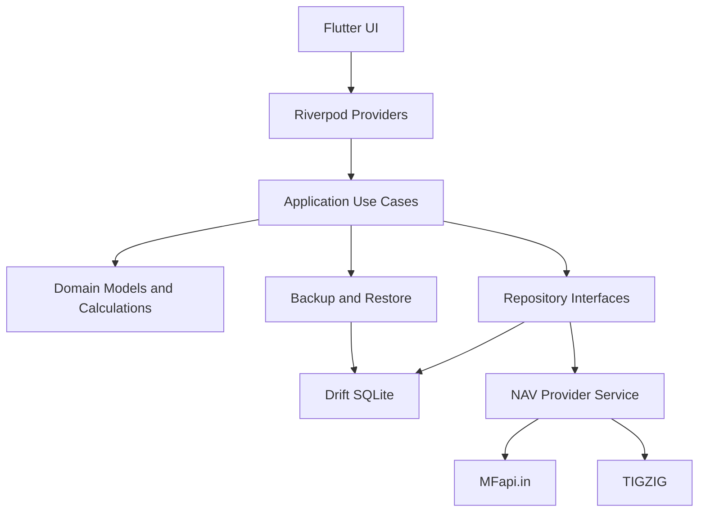

# Application Architecture

## 1. Architecture Overview

The application follows an offline-first, feature-oriented architecture.

The application does not require a backend server.

Flutter handles the user interface, Riverpod handles application state, Drift manages SQLite persistence, and dedicated data providers retrieve NAV information.

## 2. Technology Stack

| Layer              | Technology                  |
| ------------------ | --------------------------- |
| UI                 | Flutter                     |
| Language           | Dart                        |
| State management   | Riverpod                    |
| Local database     | Drift                       |
| Database engine    | SQLite                      |
| Networking         | Dio                         |
| JSON serialization | json_serializable           |
| Charts             | fl_chart                    |
| Notifications      | flutter_local_notifications |
| Date handling      | intl                        |
| Backup             | JSON                        |
| Connectivity       | connectivity_plus           |

Use current stable, mutually compatible package versions at implementation time. Avoid unnecessary dependencies.

## 3. Architectural Layers

### Presentation Layer

Responsible for:

- Screens.
- Widgets.
- Navigation.
- Forms.
- User interactions.
- Visual charts.

The presentation layer must not directly access SQLite or external APIs.

### Application Layer

Responsible for:

- Use cases.
- Application workflows.
- SIP processing.
- Portfolio calculations.
- NAV synchronization orchestration.

Examples:

- CreateSIP.
- GenerateScheduledContributions.
- SyncMutualFundNAV.
- CalculatePortfolio.
- CalculateXIRR.
- ImportBackup.
- ExportBackup.

### Domain Layer

Responsible for:

- Core entities.
- Business rules.
- Investment calculations.
- SIP scheduling rules.
- Portfolio valuation rules.

The domain layer should not depend on Flutter widgets, Drift or Dio.

### Data Layer

Responsible for:

- Drift database.
- Repositories.
- External API clients.
- JSON parsing.
- Backup serialization.

## 4. Application Architecture Diagram



## 5. Recommended Project Structure

```text
investment_tracker/
│
├── android/
├── assets/
│   ├── icons/
│   ├── images/
│   └── fonts/
│
├── lib/
│   ├── main.dart
│   ├── app.dart
│   │
│   ├── core/
│   │   ├── constants/
│   │   ├── errors/
│   │   ├── extensions/
│   │   ├── formatting/
│   │   ├── routing/
│   │   ├── theme/
│   │   └── utils/
│   │
│   ├── database/
│   │   ├── app_database.dart
│   │   ├── connection/
│   │   ├── tables/
│   │   └── daos/
│   │
│   ├── domain/
│   │   ├── entities/
│   │   ├── enums/
│   │   ├── repositories/
│   │   └── calculations/
│   │
│   ├── data/
│   │   ├── models/
│   │   ├── repositories/
│   │   ├── datasources/
│   │   │   ├── local/
│   │   │   └── remote/
│   │   ├── nav/
│   │   │   ├── nav_provider.dart
│   │   │   ├── mfapi_provider.dart
│   │   │   └── tigzig_provider.dart
│   │   └── backup/
│   │
│   ├── features/
│   │   ├── dashboard/
│   │   ├── mutual_funds/
│   │   ├── sip/
│   │   ├── transactions/
│   │   ├── portfolio/
│   │   ├── calendar/
│   │   ├── analytics/
│   │   ├── notifications/
│   │   └── settings/
│   │
│   └── providers/
│       ├── database_provider.dart
│       ├── repository_providers.dart
│       └── app_providers.dart
│
├── test/
│   ├── unit/
│   ├── widget/
│   ├── integration/
│   └── fixtures/
│
├── docs/
│   ├── prod.md
│   ├── architecture.md
│   ├── essential-architecture.md
│   └── agent.md
│
├── pubspec.yaml
├── analysis_options.yaml
├── CHANGELOG.md
└── README.md
```

## 6. Navigation

Use a bottom navigation layout.

Main sections:

1. Dashboard.
2. Investments.
3. SIPs.
4. Analytics.
5. Settings.

Use nested routes for detailed screens.

Avoid loading all historical NAV data when opening the dashboard.

## 7. State Management

Use Riverpod for dependency injection and application state.

Recommended provider categories:

- Database providers.
- Repository providers.
- NAV synchronization providers.
- SIP providers.
- Portfolio providers.
- Dashboard providers.
- Settings providers.

Use asynchronous providers for operations involving database reads or network access.

Avoid putting business logic directly inside widgets.

## 8. Database Access

Drift should be the single persistence layer.

Requirements:

- Use typed tables.
- Use DAOs for database queries.
- Use database migrations.
- Use transactions for multi-table operations.
- Add indexes to frequently queried fields.
- Avoid direct SQL scattered across features.

## 9. NAV Synchronization Architecture

Create a common NAV provider interface.

Conceptual interface:

```dart
abstract interface class NavDataProvider {
  Future<List<MutualFundScheme>> searchSchemes(
    String query,
  );

  Future<NavData?> getLatestNav(
    String schemeCode,
  );

  Future<List<NavData>> getHistoricalNav(
    String schemeCode,
  );
}
```

Implement separate adapters:

- MfapiProvider.
- TigzigProvider.

A NavService coordinates the adapters.

Responsibilities:

1. Read local NAV cache.
2. Check data freshness.
3. Query the primary provider.
4. Validate the response.
5. Use the fallback provider if necessary.
6. Persist valid NAV data.
7. Preserve existing data on failure.
8. Return synchronization status.

Do not couple the application to a particular API's JSON response format.

Provider endpoints, response mappings and limits must be validated against current provider documentation before implementation.

## 10. Synchronization Strategy

The application must not continuously poll external APIs.

Recommended behavior:

- On dashboard access, check data freshness.
- Fetch only selected schemes.
- Avoid duplicate concurrent requests.
- Use a configurable freshness threshold.
- Provide manual synchronization.
- Store successful synchronization timestamps.
- Retry failed requests on a later opportunity.

Default NAV freshness threshold: 24 hours.

Use a longer retry interval after repeated failures.

## 11. Background Processing

No mandatory background worker or continuously running service.

The initial application processes overdue SIP schedules when:

- The application starts.
- The dashboard is accessed.
- The user accesses the SIP section.

Optional Android background scheduling can be added in a later release.

Scheduled notifications are separate from actual contribution processing.

## 12. Offline Behavior

When offline:

- Display saved portfolio information.
- Display saved NAV values.
- Display NAV dates.
- Permit SIP editing.
- Permit transaction editing.
- Permit calculations.
- Permit backup and export.
- Queue no external financial transactions.

Display a clear offline indicator when NAV synchronization cannot be performed.

## 13. Security and Privacy

- Store data in Android application-private storage.
- Do not request unnecessary permissions.
- Do not collect financial information externally.
- Do not embed secret credentials in the application.
- Validate imported backup files.
- Avoid logging financial transaction details.
- Support application data deletion.

## 14. Error Handling

Handle:

- No internet.
- API timeout.
- Invalid API response.
- Missing scheme.
- Missing NAV.
- Outdated NAV.
- Database migration failure.
- Backup corruption.
- Duplicate contribution.
- Invalid transaction.
- Calculation errors.

All recoverable errors should be displayed with understandable messages.

## 15. Testing Strategy

Unit tests:

- SIP schedule generation.
- Monthly date handling.
- NAV parsing.
- Unit calculations.
- Portfolio valuation.
- XIRR.
- Redemption calculations.

Integration tests:

- SQLite persistence.
- NAV synchronization.
- Fallback provider.
- Backup and restore.
- Database migration.

Widget tests:

- Dashboard.
- SIP forms.
- Investment lists.
- Transaction forms.
- Analytics.
