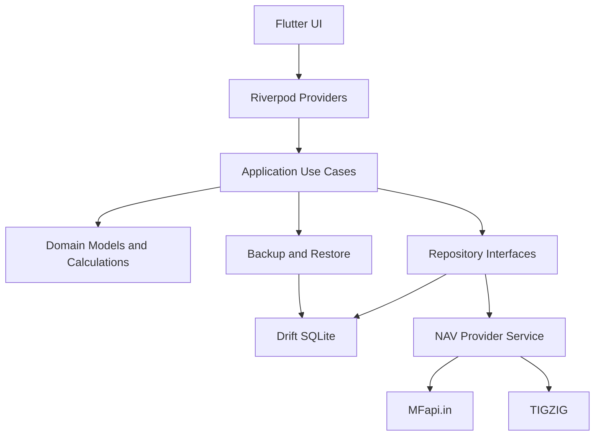
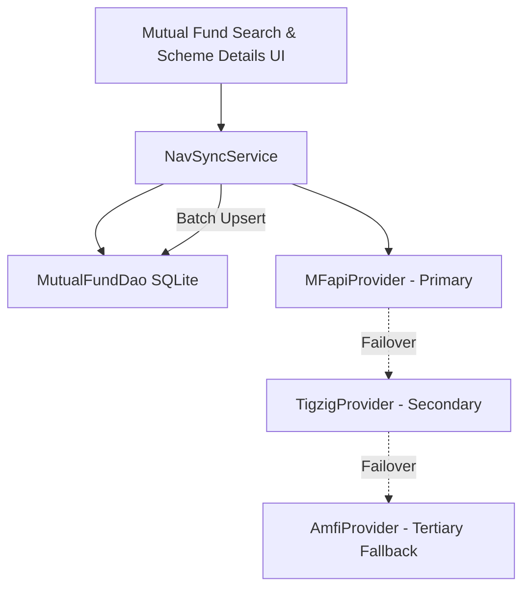

# FinBalance Application Architecture

## 1. Architecture Overview

FinBalance follows an offline-first, feature-oriented architecture structured around a unified personal balance sheet:
- **Net Worth Overview:** Aggregating dynamic assets and liabilities.
- **Assets Engine:** Mutual fund schemes, historical NAVs, SIP configurations, scheduled installments, and holdings.
- **Liabilities Engine:** Loans, credit lines, repayment commitments, and EMI tracking.
- **Persistence:** Local SQLite via Drift.
- **State & DI:** Riverpod.
- **External Sync:** Independent NAV provider adapters for public mutual fund metrics.

## 2. Technology Stack

| Layer              | Technology                  |
| ------------------ | --------------------------- |
| UI                 | Flutter                     |
| Language           | Dart                        |
| State management   | Riverpod                    |
| Local database     | Drift                       |
| Database engine    | SQLite                      |
| Networking         | Dio                         |
| JSON serialization | json_serializable           |
| Charts             | fl_chart                    |
| Notifications      | flutter_local_notifications |
| Date handling      | intl                        |
| Backup             | JSON                        |
| Connectivity       | connectivity_plus           |

Use current stable, mutually compatible package versions at implementation time. Avoid unnecessary dependencies.

## 3. Architectural Layers

### Presentation Layer

Responsible for:

- Screens.
- Widgets.
- Navigation.
- Forms.
- User interactions.
- Visual charts.

The presentation layer must not directly access SQLite or external APIs.

### Application Layer

Responsible for:

- Use cases.
- Application workflows.
- SIP processing.
- Portfolio calculations.
- NAV synchronization orchestration.

Examples:

- CreateSIP.
- GenerateScheduledContributions.
- SyncMutualFundNAV.
- CalculatePortfolio.
- CalculateXIRR.
- ImportBackup.
- ExportBackup.

### Domain Layer

Responsible for:

- Core entities.
- Business rules.
- Investment calculations.
- SIP scheduling rules.
- Portfolio valuation rules.

The domain layer should not depend on Flutter widgets, Drift or Dio.

### Data Layer

Responsible for:

- Drift database.
- Repositories.
- External API clients.
- JSON parsing.
- Backup serialization.

## 4. Application Architecture Diagram



## 5. Recommended Project Structure

```text
investment_tracker/
│
├── android/
├── assets/
│   ├── icons/
│   ├── images/
│   └── fonts/
│
├── lib/
│   ├── main.dart
│   ├── app.dart
│   │
│   ├── core/
│   │   ├── constants/
│   │   ├── errors/
│   │   ├── extensions/
│   │   ├── formatting/
│   │   ├── routing/
│   │   ├── theme/
│   │   └── utils/
│   │
│   ├── database/
│   │   ├── app_database.dart
│   │   ├── connection/
│   │   │   └── connection.dart
│   │   ├── precision/
│   │   │   └── financial_precision.dart
│   │   ├── tables/
│   │   │   ├── financial_profiles.dart
│   │   │   ├── financial_categories.dart
│   │   │   ├── financial_accounts.dart
│   │   │   ├── financial_items.dart
│   │   │   ├── transactions.dart
│   │   │   ├── valuation_history.dart
│   │   │   ├── recurring_transactions.dart
│   │   │   └── app_settings.dart
│   │   └── daos/
│   │       ├── profiles_dao.dart
│   │       ├── categories_dao.dart
│   │       ├── accounts_dao.dart
│   │       ├── financial_items_dao.dart
│   │       ├── transactions_dao.dart
│   │       ├── valuations_dao.dart
│   │       ├── recurring_transactions_dao.dart
│   │       └── app_settings_dao.dart
│   │
│   ├── domain/
│   │   ├── entities/
│   │   ├── enums/
│   │   ├── repositories/
│   │   └── calculations/
│   │
│   ├── data/
│   │   ├── models/
│   │   ├── repositories/
│   │   ├── datasources/
│   │   │   ├── local/
│   │   │   └── remote/
│   │   ├── nav/
│   │   │   ├── nav_provider.dart
│   │   │   ├── mfapi_provider.dart
│   │   │   └── tigzig_provider.dart
│   │   └── backup/
│   │
│   ├── features/
│   │   ├── dashboard/
│   │   ├── mutual_funds/
│   │   ├── sip/
│   │   ├── transactions/
│   │   ├── portfolio/
│   │   ├── calendar/
│   │   ├── analytics/
│   │   ├── notifications/
│   │   └── settings/
│   │
│   └── providers/
│       ├── database_provider.dart
│       ├── repository_providers.dart
│       └── app_providers.dart
│
├── test/
│   ├── unit/
│   ├── widget/
│   ├── integration/
│   └── fixtures/
│
├── docs/
│   ├── prod.md
│   ├── architecture.md
│   ├── essential-architecture.md
│   └── agent.md
│
├── pubspec.yaml
├── analysis_options.yaml
├── CHANGELOG.md
└── README.md
```

## 6. Navigation

Use a bottom navigation layout.

Main sections:

1. Dashboard.
2. Investments.
3. SIPs.
4. Analytics.
5. Settings.

Use nested routes for detailed screens.

Avoid loading all historical NAV data when opening the dashboard.

## 7. State Management

Use Riverpod for dependency injection and application state.

Recommended provider categories:

- Database providers.
- Repository providers.
- NAV synchronization providers.
- SIP providers.
- Portfolio providers.
- Dashboard providers.
- Settings providers.

Use asynchronous providers for operations involving database reads or network access.

Avoid putting business logic directly inside widgets.

## 8. Database Access

Drift is the single, local SQLite persistence layer.

Requirements:

- Use typed tables organized under `lib/database/tables/`.
- Use specialized DAOs under `lib/database/daos/` for all database interactions.
- Zero floating point drift: Store amounts in 64-bit integer minor units (Paise), units in micro-units ($10^{-6}$), NAV in micro-paise ($10^{-6}$ INR), and rates in basis points ($10^{-4}$).
- Riverpod integration: Access `AppDatabase` and DAOs via `database_provider.dart` (`databaseProvider`, `categoriesDaoProvider`, `accountsDaoProvider`, `financialItemsDaoProvider`, `transactionsDaoProvider`, `valuationsDaoProvider`, `recurringTransactionsDaoProvider`, `appSettingsDaoProvider`).
- Foreign key enforcement: `PRAGMA foreign_keys = ON;` in SQLite connection initialization.
- Use composite unique key constraints (e.g. `{financialItemId, valuationDate}`) and Drift `DoUpdate` targeting composite keys for atomic upserts.
- Use transactions and batching for multi-row operations.
- Avoid direct SQL scattered across features.

## 9. NAV Synchronization Architecture

FinBalance implements a provider-independent NAV integration layer under `lib/data/nav/`:



### 9.1 Provider Priority & Implementation

1. **MFapiProvider (Primary):**
   - Base URL: `https://api.mfapi.in`
   - Scheme Search: `/mf/search?q={query}`
   - Latest Details: `/mf/{schemeCode}/latest`
   - Historical Details: `/mf/{schemeCode}`
   - Date format: `DD-MM-YYYY`
   - NAV precision: Stored as 64-bit integer micro-paise (`$10^{-6}$` INR) without floating-point conversion drift.
2. **TigzigProvider (Secondary):**
   - Base URL: `https://api.tigzig.com/mf/v1`
   - Subject to Cloudflare security checks. When Cloudflare responds with HTTP 403 (Error 1006), the adapter cleanly reports `isAvailable() == false` without throwing or attempting unauthorized circumvention, seamlessly passing to the fallback provider.
3. **AmfiProvider (Tertiary Fallback):**
   - URL: `https://portal.amfiindia.com/spages/NAVAll.txt`
   - Official AMFI semicolon-delimited text format: `Scheme Code;ISIN Div Payout/ISIN Growth;ISIN Div Reinvestment;Scheme Name;Plan;Option;Net Asset Value;Date`.
   - Parses date format `DD-MMM-YYYY` (e.g. `29-Oct-2026`).

### 9.2 Synchronization Workflow (`NavSyncService`)

1. **Cache-First Discovery:** Reads locally cached schemes from `MutualFundSchemes` in SQLite.
2. **Online Query & Caching:** Queries active remote providers, caches discovered scheme metadata, and avoids redundant downloads.
3. **Valuation Propagation:** When a new NAV is fetched for `schemeCode`, `MutualFundDao.syncHoldingsValuation()` automatically recalculates `currentValuationPaise` across all profiles holding the fund in `FinancialItems` and writes to `ValuationHistory`.

## 10. Synchronization Strategy

The application must not continuously poll external APIs.

Recommended behavior:

- On dashboard access, check data freshness.
- Fetch only selected schemes.
- Avoid duplicate concurrent requests.
- Use a configurable freshness threshold.
- Provide manual synchronization.
- Store successful synchronization timestamps.
- Retry failed requests on a later opportunity.

Default NAV freshness threshold: 24 hours.

Use a longer retry interval after repeated failures.

## 11. Background Processing

No mandatory background worker or continuously running service.

The initial application processes overdue SIP schedules when:

- The application starts.
- The dashboard is accessed.
- The user accesses the SIP section.

Optional Android background scheduling can be added in a later release.

Scheduled notifications are separate from actual contribution processing.

## 12. Offline Behavior

When offline:

- Display saved portfolio information.
- Display saved NAV values.
- Display NAV dates.
- Permit SIP editing.
- Permit transaction editing.
- Permit calculations.
- Permit backup and export.
- Queue no external financial transactions.

Display a clear offline indicator when NAV synchronization cannot be performed.

## 13. Security and Privacy

- Store data in Android application-private storage.
- Do not request unnecessary permissions.
- Do not collect financial information externally.
- Do not embed secret credentials in the application.
- Validate imported backup files.
- Avoid logging financial transaction details.
- Support application data deletion.

## 14. Error Handling

Handle:

- No internet.
- API timeout.
- Invalid API response.
- Missing scheme.
- Missing NAV.
- Outdated NAV.
- Database migration failure.
- Backup corruption.
- Duplicate contribution.
- Invalid transaction.
- Calculation errors.

All recoverable errors should be displayed with understandable messages.

## 15. Testing Strategy

Unit tests:

- SIP schedule generation.
- Monthly date handling.
- NAV parsing.
- Unit calculations.
- Portfolio valuation.
- XIRR.
- Redemption calculations.

Integration tests:

- SQLite persistence.
- NAV synchronization.
- Fallback provider.
- Backup and restore.
- Database migration.

Widget tests:

- Dashboard.
- SIP forms.
- Investment lists.
- Transaction forms.
- Analytics.

---

## 16. Multi-Profile Management, Holdings Workflow & Flutter Web Architecture

### 16.1 Profile Lifecycle & Family Finance
- **Profile Creation & Customization:** `ProfileFormDialog` handles person name, relationship mapping, avatar color palette, notes, and default flag.
- **Fast Profile Switcher:** `ProfileSelectorButton` in the AppBar opens `ProfileSwitcherSheet` for immediate profile switching.
- **Profile Management:** `ProfileManagementScreen` enables editing, archiving, restoring, and default designating. Profiles with recorded financial data (`hasFinancialHistory`) cannot be deleted, preventing accidental record loss.
- **Strict Data Isolation:** All financial queries are scoped to `activeProfileIdProvider`. Changing profiles triggers immediate reactive updates across Overview, Assets, and all child widgets.

### 16.2 Mutual Fund Holdings & Portfolio Reactive Flow
- **Holding Management:** `AddToProfileDialog` calculates purchased units using published NAV, saves the asset in `FinancialItems` for the active profile, and records an initial ledger purchase in `Transactions`. Subsequent purchases in the same fund aggregate into the existing holding.
- **Real-Time Display:** `AssetsScreen` watches `activeProfileAssetsProvider` and displays `HoldingCard` items with live current valuation, invested amount, and gain/loss metrics.

### 16.3 Dual-Platform Drift Persistence (Android & Web)
- **Native Android:** SQLite connection via `drift_flutter` with cross-isolate sharing (`DriftNativeOptions`).
- **Flutter Web:** SQLite3 WebAssembly (`sqlite3.wasm`) execution with dedicated worker (`drift_worker.js`) via `driftDatabase`'s `DriftWebOptions`.
- **Responsive Layout:** Responsive `MainScaffold` renders a `NavigationRail` for wide viewports (>= 720px) and a bottom `NavigationBar` on mobile viewports.

---

## 17. Mutual Fund Investment Schedules, Historical NAV Valuation & Branding Identity

### 17.1 Automated Investment Schedule Architecture
- **`InvestmentScheduleService`:** Reusable schedule generator supporting Daily, Weekly, Monthly, Quarterly, Yearly, and One-Time frequencies. Calculates occurrences with zero progressive date drift and leap-year month-end clamping (Feb 28/29, Apr 30, Jan 31). Dynamically partitions occurrences into Past ($\le \text{today}$) and Future ($> \text{today}$) based on device local date.
- **`AddToProfileDialog`:** Redesigned investment schedule addition form with live schedule projection, profile selection, amount per installment, start date picker, frequency selector, installment count, and confirmed/estimate toggle.

### 17.2 Historical NAV-Based Valuation Lifecycle
- **`MutualFundDao.getNavOnOrBefore`:** Retrieves the applicable historical NAV for each past installment date, falling back gracefully across weekends (Saturday/Sunday $\to$ Friday) and market holidays to the preceding trading day.
- **`pending_valuation` Status:** If historical NAV data is missing, installments are marked as `pending_valuation` without inventing artificial quotes. Revaluation is retried via `revaluePendingInstallments` once NAV data is downloaded.
- **Strict Financial Isolation:** Future planned contributions are recorded as `upcoming` simulated installments with null units and null purchase NAV. They are strictly excluded from current portfolio valuation and net worth.

### 17.3 Schedule Editing & Historical Preservation
- **`EditSipScheduleDialog`:** Allows modifying frequency, installment amount, and remaining installments from an effective date.
- **Historical Immutability:** Only future installments on or after the effective date are modified. Past confirmed transactions, units, and purchase NAVs are strictly preserved.

### 17.4 Application Branding & Visual Identity
- **Geometric Symbolism:** Clean geometric fintech branding representing Assets (+) Emerald Green (`#10B981`), Liabilities (−) Cobalt Blue (`#2563EB`), and Net Worth Balance Golden Amber (`#F59E0B`).
- **Platform Deliverables:** Android adaptive vector drawables (`ic_launcher_foreground.xml`, `ic_launcher_background.xml`), all standard Android mipmap densities (`mdpi`, `hdpi`, `xhdpi`, `xxhdpi`, `xxxhdpi`), Web icons (192, 512, maskable, favicon).
- **In-App `FinBalanceLogo`:** In-app vector Flutter widget providing scalable, theme-aware vector rendering across `ProfileSelectionScreen`, `SettingsScreen`, and `MainScaffold`.

---

## 18. Mobile UX, Navigation, Activity Ledger & Cash Flow Architecture

### 18.1 Mobile-First Addition Form UX
- **Edge-to-Edge Mobile Page:** Replaced modal dialogs on mobile viewports with full-page `Scaffold` routes using `MaterialPageRoute(fullscreenDialog: true)`.
- **Persistent Header Call-to-Action:** Positioned the primary Save action in the AppBar (`actions: [FilledButton(...)]`), maintaining thumb reachability without keyboard occlusion or needing to scroll to the bottom of the form.
- **Single-Column Responsive Flow:** Stacks form fields vertically on compact phone viewports to prevent horizontal overflow and crowded multi-column inputs.
- **Collapsible Inspection:** Secondary data, such as generated installment date previews, are encapsulated in collapsible `ExpansionTile` widgets to keep initial form length manageable.

### 18.2 Navigation & Centralized Controls
- **`ReturnToProfilesButton`:** Persistent top-left navigation control (`Icons.switch_account_rounded`) across Overview, Assets, Liabilities, Activity, and Settings screens. Modifies `hasSelectedInitialProfileProvider.state = false` returning to the family profile selector without destroying database connections or active session state.
- **Context-Aware Circular Floating Action Button (`+`):** Unified circular FAB in `MainScaffold` dynamically adapting its bottom sheet actions based on the active destination index (Overview: quick add sheet; Assets: asset actions; Liabilities: direct liability modal; Activity: transaction entry; Settings: null).
- **Settings-Only Centralized NAV Synchronization:** NAV refresh triggers and sync buttons removed from user-facing asset lists and holdings sheets. Full sync policies, status timestamps, and error diagnostics are maintained strictly within Settings.

### 18.3 Activity Ledger & Cash Flow Domain Engine
- **Database-Driven Activity Ledger:** Replaced mock activity entries with reactive queries against `TransactionsDao` filtered by active profile. Supports multi-dimension filtering:
  - Transaction type: All, Income, Expense, Investment, Transfer.
  - Date presets: All, Today, This Month, Last Month, Custom Date Range.
  - Categories: Filter by category ID with instant Reset.
  - Deletion lifecycle: Confirmation dialog triggering `TransactionsDao.deleteTransaction`.
- **Cash Flow Analysis:** Segregated analysis view calculating Net Cash Flow (`Income - Expenses`) and Savings Rate (`((Income - Expenses) / Income) * 100%`) over selectable time intervals (This Month, Last Month, 3 Months, 6 Months, This Year, Custom).
- **Category Proportions:** Renders proportional progress indicators for income sources and expense categories (sorted descending).
- **Transfer Isolation:** Transactions with `transactionType == 'transfer'` are strictly excluded from income and expense aggregates to prevent artificial inflation of user cash flows.


