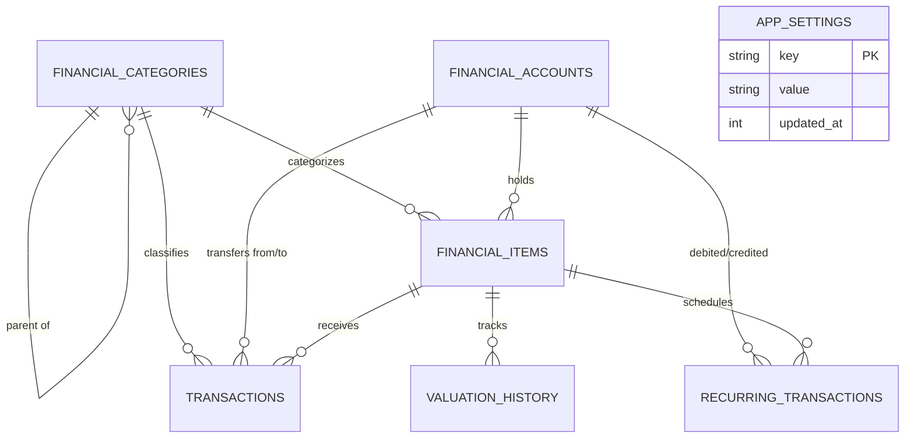

# Document 3: essential-architecture.md

# Essential Architecture — Unified Personal Finance Model & Calculation Engine

## 1. Core Design Principles

FinBalance models the full financial position of an individual. The database distinguishes between:

1. **Assets & Investments:**
   - Mutual fund scheme information.
   - SIP configurations and scheduled installments.
   - Simulated transactions vs. user-entered/imported transactions.
   - Historical NAV time-series.
   - Future asset categories (stocks, FDs, gold).

2. **Liabilities & Debt:**
   - Liabilities (loans, credit card balances).
   - Scheduled repayment commitments (EMIs).
   - Debt payoff transactions.

3. **Net Worth & Analytics:**
   - Net Worth = Total Assets - Total Liabilities.
   - Debt-to-Asset ratio.
   - Dated cash flows for investment XIRR.

Do not combine all these concepts into one monolithic table.

## 2. Database Schema (Drift / SQLite)

The database schema is fully normalized into seven primary entities designed around a unified personal balance sheet:



### 2.1 Integer Precision Strategy (Zero Floating-Point Drift)

To guarantee 100% financial calculation accuracy and eliminate floating-point rounding errors:
- **Currency Amounts:** Stored as 64-bit integer minor units (Paise for INR, where $₹1 = 100\text{ Paise}$). On 64-bit Android/Linux, Dart `int` supports up to $\approx 9.22 \times 10^{18}$ Paise ($> ₹92\text{ quadrillion}$), completely preventing overflow and float approximation.
- **Investment Units:** Stored as 64-bit integer micro-units ($1\text{ Unit} = 1,000,000\text{ micro-units}$, 6 decimal places). Accurately handles mutual fund fractional allotments (e.g., $125.4567\text{ units} = 125,456,700\text{ micro-units}$).
- **NAV / Unit Price:** Stored as 64-bit integer micro-paise ($₹1 = 100\text{ Paise} = 1,000,000\text{ micro-paise}$). AMFI mutual fund NAVs publish up to 4 decimal places of INR (e.g., $₹125.4560 = 125,456,000\text{ micro-paise}$).
- **Interest Rates:** Stored in basis points ($1\% = 100\text{ bps}$, e.g., $8.50\% = 850\text{ bps}$).

Conversion utilities reside in `FinancialPrecision` (`lib/database/precision/financial_precision.dart`).

---

### 2.2 Table Definitions

#### A. `FinancialCategories` (`financial_categories`)
Taxonomy for classifying assets, liabilities, income, and expense activities.
- `id` (INTEGER, PK, AutoIncrement)
- `name` (TEXT)
- `classification` (TEXT: `asset`, `liability`, `income`, `expense`)
- `parent_id` (INTEGER, Nullable, FK $\to$ `financial_categories.id` ON DELETE SET NULL)
- `icon` (TEXT, Default: `'folder'`)
- `color_hex` (TEXT, Default: `'#10B981'`)
- `is_custom` (BOOLEAN, Default: `false`)
- `is_archived` (BOOLEAN, Default: `false`)
- `created_at` (INTEGER, Unix timestamp)

#### B. `FinancialAccounts` (`financial_accounts`)
Real or virtual institutions, wallets, bank accounts, or loan accounts holding positions.
- `id` (INTEGER, PK, AutoIncrement)
- `name` (TEXT)
- `account_type` (TEXT: `bank`, `cash`, `demat`, `wallet`, `loan_account`, `credit_card`)
- `account_number_masked` (TEXT, Nullable, e.g. `'XX1234'`)
- `institution_name` (TEXT, Nullable, e.g. `'HDFC Bank'`)
- `opening_balance_paise` (INTEGER, Default: `0`)
- `current_balance_paise` (INTEGER, Default: `0`)
- `is_archived` (BOOLEAN, Default: `false`)
- `created_at` / `updated_at` (INTEGER)

#### C. `FinancialItems` (`financial_items`)
First-class representations of individual assets (mutual funds, stocks, gold, FDs) and liabilities (home loans, vehicle loans, credit cards).
- `id` (INTEGER, PK, AutoIncrement)
- `name` (TEXT, e.g. `'Parag Parikh Flexi Cap Fund - Direct Growth'`)
- `item_type` (TEXT: `asset` vs `liability`)
- `sub_type` (TEXT: `mutual_fund`, `stock`, `etf`, `fd`, `gold`, `ppf`, `epf`, `nps`, `home_loan`, `personal_loan`, `vehicle_loan`, `credit_card`, `other`)
- `category_id` (INTEGER, FK $\to$ `financial_categories.id` ON DELETE RESTRICT)
- `account_id` (INTEGER, Nullable, FK $\to$ `financial_accounts.id` ON DELETE SET NULL)
- `external_code` (TEXT, Nullable, AMFI Scheme Code e.g. `'122639'`)
- `isin` (TEXT, Nullable)
- `status` (TEXT: `active`, `paused`, `closed`, `matured`)
- `initial_value_paise` (INTEGER, Default: `0`)
- `current_valuation_paise` (INTEGER, Default: `0`)
- `unit_count_micro_units` (INTEGER, Default: `0`)
- `interest_rate_basis_points` (INTEGER, Nullable)
- `tenure_months` (INTEGER, Nullable)
- `maturity_date` / `start_date` (INTEGER, Nullable)
- `metadata_json` (TEXT, Nullable, Extensible properties)
- `created_at` / `updated_at` (INTEGER)

#### D. `Transactions` (`transactions`)
Immutable financial ledger capturing double-entry movement, purchases, redemptions, loan payments, and income/expense flows.
- `id` (INTEGER, PK, AutoIncrement)
- `transaction_type` (TEXT: `income`, `expense`, `transfer`, `investment_purchase`, `investment_redemption`, `debt_repayment`, `adjustment`)
- `category_id` (INTEGER, FK $\to$ `financial_categories.id` ON DELETE RESTRICT)
- `financial_item_id` (INTEGER, Nullable, FK $\to$ `financial_items.id` ON DELETE CASCADE)
- `from_account_id` (INTEGER, Nullable, FK $\to$ `financial_accounts.id` ON DELETE SET NULL)
- `to_account_id` (INTEGER, Nullable, FK $\to$ `financial_accounts.id` ON DELETE SET NULL)
- `transaction_date` (INTEGER, Unix timestamp)
- `amount_paise` (INTEGER, Value in Paise)
- `units_micro_units` (INTEGER, Nullable, Units bought/sold)
- `unit_price_micro_paise` (INTEGER, Nullable, Price/NAV at transaction)
- `fee_paise` / `tax_paise` (INTEGER, Default: `0`)
- `source` (TEXT: `manual`, `simulated_sip`, `recurring_emi`, `csv_import`, `cas_import`)
- `notes` (TEXT, Nullable)
- `created_at` (INTEGER)

#### E. `ValuationHistory` (`valuation_history`)
Time-series of historical valuations and unit prices (daily NAVs, gold rates, stock prices).
- `id` (INTEGER, PK, AutoIncrement)
- `financial_item_id` (INTEGER, FK $\to$ `financial_items.id` ON DELETE CASCADE)
- `valuation_date` (INTEGER, Normalized to start-of-day UTC)
- `valuation_paise` (INTEGER, Value in Paise)
- `unit_price_micro_paise` (INTEGER, Nullable, NAV in micro-paise)
- `source_provider` (TEXT, Nullable, e.g. `'mfapi'`, `'tigzig'`, `'manual'`)
- `created_at` (INTEGER)
- **Unique Constraint:** `(financial_item_id, valuation_date)`

#### F. `RecurringTransactions` (`recurring_transactions`)
Schedules and configurations for simulated SIP investments, loan EMIs, recurring deposits, and regular cash flows.
- `id` (INTEGER, PK, AutoIncrement)
- `name` (TEXT, e.g. `'PPFCF Monthly SIP'`)
- `recurring_type` (TEXT: `sip_investment`, `loan_emi`, `recurring_income`, `recurring_expense`)
- `financial_item_id` (INTEGER, Nullable, FK $\to$ `financial_items.id` ON DELETE CASCADE)
- `from_account_id` (INTEGER, Nullable, FK $\to$ `financial_accounts.id` ON DELETE SET NULL)
- `to_account_id` (INTEGER, Nullable, FK $\to$ `financial_accounts.id` ON DELETE SET NULL)
- `category_id` (INTEGER, Nullable, FK $\to$ `financial_categories.id` ON DELETE SET NULL)
- `amount_paise` (INTEGER, Scheduled amount in Paise)
- `frequency` (TEXT: `daily`, `weekly`, `fortnightly`, `monthly`, `quarterly`, `yearly`)
- `scheduled_day` (INTEGER, Day of month `1..31` or day of week `1..7`)
- `start_date` (INTEGER)
- `end_date` (INTEGER, Nullable)
- `next_execution_date` (INTEGER, Nullable)
- `status` (TEXT: `active`, `paused`, `cancelled`, `completed`)
- `auto_process` (BOOLEAN, Default: `true`)
- `created_at` / `updated_at` (INTEGER)

#### G. `AppSettings` (`app_settings`)
Simple, typed key-value configuration store for application-wide states.
- `key` (TEXT, PK)
- `value` (TEXT)
- `updated_at` (INTEGER)

---

### 2.3 Data Access Objects (DAOs)

Every table has a dedicated DAO exposing reactive Drift `Stream` queries and atomic `Future` mutations:
1. `CategoriesDao`: Fetch active categories by classification, manage custom categories, query hierarchy.
2. `AccountsDao`: Reactive balance watchers, account archiving, net liquidity aggregation.
3. `FinancialItemsDao`: Watch assets vs. liabilities, query items by status/subtype, update holdings and valuations.
4. `TransactionsDao`: Watch ledger with pagination, query date ranges, aggregate sums by category/item.
5. `ValuationsDao`: Upsert daily valuations using `DoUpdate` targeting composite `(financialItemId, valuationDate)`, query date windows for charting.
6. `RecurringTransactionsDao`: Track active schedules, retrieve due installments, update execution timestamps.
7. `AppSettingsDao`: Key-value get, set, delete, and watcher streams.

---

### 2.4 Integrity & Migrations

- **Foreign Key Enforcement:** `PRAGMA foreign_keys = ON;` is explicitly executed in Drift's `beforeOpen` callback to enforce relational integrity in SQLite.
- **Cascading Rules:** Deleting a `financial_item` automatically removes its linked `valuation_history` and `recurring_transactions` schedules via `CASCADE`.
- **Schema Versioning:** Managed through Drift's `MigrationStrategy(schemaVersion: 1, onCreate: ..., onUpgrade: ...)`. New schema changes must be incremented with explicit migration steps and verified using in-memory and migration tests.

## 4. SIP Scheduling Engine

The SIP scheduler generates expected contribution dates.

Example:

Start date: 31 January 2026.

Frequency: Monthly.

Generated dates should be:

- 31 January.
- 28 February.
- 31 March.
- 30 April.
- 31 May.

For monthly SIPs, preserve the originally configured day when possible. If the month does not contain that day, use its final calendar day.

Do not repeatedly add one month to the previous adjusted date. That would incorrectly shift subsequent dates.

The schedule generator should calculate every occurrence independently from the original schedule configuration.

For stopped SIPs, do not generate new contributions after the effective stop date.

For paused SIPs, skip the applicable scheduled periods without generating investment transactions.

For amount changes, apply the new amount only from its effective date.

Historical contributions must remain unchanged.

## 5. Automatic Contribution Processing

When a scheduled contribution becomes due:

1. Retrieve the scheduled installment.
2. Check for an existing transaction.
3. Check the SIP status.
4. Determine the applicable NAV.
5. Generate the simulated contribution.
6. Calculate estimated units.
7. Save the transaction.
8. Update installment status.
9. Recalculate portfolio totals.

Perform the database writes in one database transaction.

If no usable NAV is available, the contribution should be recorded as pending NAV valuation rather than being discarded.

When NAV becomes available, calculate the estimated units.

Never create a second contribution when retrying processing.

## 6. NAV Selection Rules

For a simulated contribution, use the latest available NAV on or before the selected valuation date.

Store:

- Selected NAV.
- NAV date.
- Data provider.
- Valuation date.

The application should clearly disclose that the simulated NAV may not equal the actual NAV applicable to a real SIP transaction.

Allow users to edit the transaction NAV.

## 7. Financial Calculations

### Units Purchased

Units = Investment Amount / NAV.

### Total Units

Total Units = Purchased Units - Redeemed Units.

### Net Invested Capital

Net Invested Capital = Purchases - Redemptions.

For more advanced reporting, distinguish gross purchases, redemptions and current holding value.

### Current Value

Current Value = Total Units × Latest NAV.

### Profit or Loss

Profit/Loss = Current Value - Net Invested Capital.

### Absolute Return

Absolute Return = (Profit/Loss / Net Invested Capital) × 100.

If net invested capital is zero, do not calculate a percentage.

### XIRR

Use dated cash flows:

- Purchases: negative cash flows.
- Redemptions: positive cash flows.
- Current portfolio value: positive terminal cash flow.

Calculate XIRR using an established numerical method such as Newton-Raphson with safeguards and a fallback method.

Display a meaningful error or unavailable state when a valid XIRR cannot be calculated.

## 8. Precision

Financial calculations should not rely on rounded display values.

Use sufficient decimal precision for:

- Investment amount.
- NAV.
- Units.
- Current value.

Round only when displaying values.

Do not use floating-point comparisons to determine transaction equality.

## 9. Portfolio Valuation

Portfolio valuation should:

1. Retrieve all active holdings.
2. Aggregate units by scheme.
3. Retrieve the latest locally stored NAV.
4. Calculate estimated market value.
5. Aggregate total investment.
6. Calculate profit/loss.
7. Calculate returns.
8. Produce fund-wise and category-wise summaries.

When NAV is stale, show the last available valuation with its NAV date.

## 10. Historical Portfolio Performance

For a historical portfolio value on a particular date:

- Use transactions recorded on or before that date.
- Calculate the remaining units.
- Retrieve the latest NAV on or before the valuation date.
- Calculate the portfolio value.

This allows historical performance charts without storing daily portfolio snapshots initially.

## 11. Backup Format

Use versioned JSON.

Example:

```json
{
  "backupVersion": 1,
  "application": "Investment Tracker",
  "exportedAt": "2026-10-30T10:00:00Z",
  "data": {
    "schemes": [],
    "sips": [],
    "installments": [],
    "transactions": [],
    "navHistory": [],
    "settings": []
  }
}
```

Import must validate:

- Backup version.
- Required fields.
- Record relationships.
- Numeric values.
- Dates.
- Duplicate identifiers.

Never silently overwrite existing investment records.
