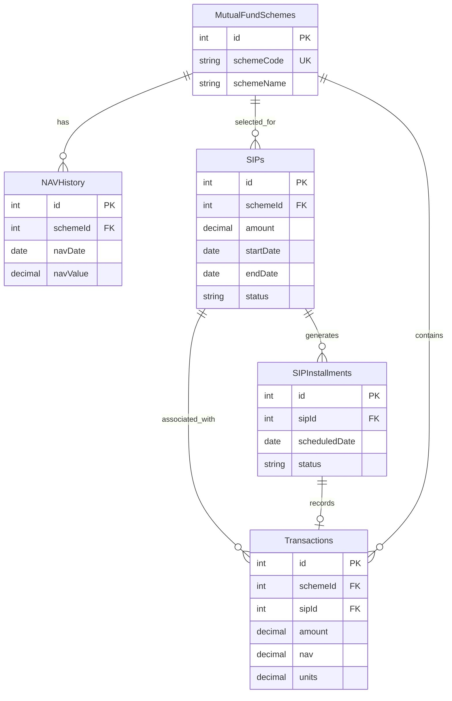

# Document 3: essential-architecture.md

# Essential Architecture — Data Model and Financial Calculation Engine

## 1. Core Design Principles

The database must distinguish between:

1. Mutual fund scheme information.
2. SIP configurations.
3. Scheduled contributions.
4. Simulated investment transactions.
5. Actual user-entered or imported transactions.
6. Historical NAV data.

Do not combine all these concepts into one table.

## 2. Database Tables

### 2.1 MutualFundSchemes

Stores mutual fund scheme information.

| Field      | Type     | Description                |
| ---------- | -------- | -------------------------- |
| id         | Integer  | Primary key                |
| schemeCode | Text     | External scheme identifier |
| schemeName | Text     | Scheme name                |
| amcName    | Text     | Asset management company   |
| category   | Text     | Fund category              |
| planType   | Text     | Direct or Regular          |
| optionType | Text     | Growth or IDCW             |
| isin       | Text?    | ISIN where available       |
| isActive   | Boolean  | Scheme availability        |
| createdAt  | DateTime | Created timestamp          |
| updatedAt  | DateTime | Updated timestamp          |

Unique constraint: schemeCode.

### 2.2 NAVHistory

Stores historical NAV records.

| Field     | Type     | Description         |
| --------- | -------- | ------------------- |
| id        | Integer  | Primary key         |
| schemeId  | Integer  | Foreign key         |
| navDate   | DateTime | NAV date            |
| navValue  | Real     | NAV                 |
| provider  | Text     | Data source         |
| fetchedAt | DateTime | Retrieval timestamp |

Unique constraint:

schemeId + navDate.

Never replace a newer NAV with an older NAV.

### 2.3 SIPs

Stores SIP configurations.

| Field        | Type      | Description                     |
| ------------ | --------- | ------------------------------- |
| id           | Integer   | Primary key                     |
| schemeId     | Integer   | Mutual fund                     |
| name         | Text      | SIP display name                |
| amount       | Real      | Investment amount               |
| frequency    | Text      | Weekly/monthly/quarterly        |
| startDate    | DateTime  | SIP start                       |
| endDate      | DateTime? | Optional end                    |
| scheduledDay | Integer   | Scheduled day                   |
| status       | Text      | Active/paused/stopped/completed |
| createdAt    | DateTime  | Created timestamp               |
| updatedAt    | DateTime  | Updated timestamp               |

### 2.4 SIPInstallments

Stores expected scheduled contributions.

| Field         | Type      | Description                         |
| ------------- | --------- | ----------------------------------- |
| id            | Integer   | Primary key                         |
| sipId         | Integer   | SIP reference                       |
| scheduledDate | DateTime  | Expected date                       |
| amount        | Real      | Scheduled amount                    |
| status        | Text      | Upcoming/recorded/skipped/cancelled |
| transactionId | Integer?  | Linked transaction                  |
| processedAt   | DateTime? | Processing time                     |

Unique constraint:

sipId + scheduledDate.

### 2.5 Transactions

Stores investment records.

| Field             | Type     | Description                    |
| ----------------- | -------- | ------------------------------ |
| id                | Integer  | Primary key                    |
| schemeId          | Integer  | Fund reference                 |
| sipId             | Integer? | Related SIP                    |
| installmentId     | Integer? | Related installment            |
| transactionType   | Text     | Purchase/redemption/adjustment |
| transactionSource | Text     | Scheduled/manual/imported      |
| transactionDate   | DateTime | Transaction date               |
| amount            | Real     | Transaction amount             |
| nav               | Real     | Applied NAV                    |
| units             | Real     | Units purchased or redeemed    |
| notes             | Text?    | Additional information         |
| createdAt         | DateTime | Creation timestamp             |
| updatedAt         | DateTime | Updated timestamp              |

### 2.6 AppSettings

Stores application preferences.

| Field | Type    | Description        |
| ----- | ------- | ------------------ |
| id    | Integer | Primary key        |
| key   | Text    | Setting identifier |
| value | Text    | Setting value      |

Examples:

- Theme.
- Currency.
- NAV refresh interval.
- Notification preferences.
- Last synchronization time.

### 2.7 Optional Future Tables

Create these only when the relevant feature is implemented:

- InvestmentGoals.
- PortfolioSnapshots.
- Watchlist.
- FundCategories.
- ImportHistory.
- BackupHistory.

## 3. Relationship Diagram



## 4. SIP Scheduling Engine

The SIP scheduler generates expected contribution dates.

Example:

Start date: 31 January 2026.

Frequency: Monthly.

Generated dates should be:

- 31 January.
- 28 February.
- 31 March.
- 30 April.
- 31 May.

For monthly SIPs, preserve the originally configured day when possible. If the month does not contain that day, use its final calendar day.

Do not repeatedly add one month to the previous adjusted date. That would incorrectly shift subsequent dates.

The schedule generator should calculate every occurrence independently from the original schedule configuration.

For stopped SIPs, do not generate new contributions after the effective stop date.

For paused SIPs, skip the applicable scheduled periods without generating investment transactions.

For amount changes, apply the new amount only from its effective date.

Historical contributions must remain unchanged.

## 5. Automatic Contribution Processing

When a scheduled contribution becomes due:

1. Retrieve the scheduled installment.
2. Check for an existing transaction.
3. Check the SIP status.
4. Determine the applicable NAV.
5. Generate the simulated contribution.
6. Calculate estimated units.
7. Save the transaction.
8. Update installment status.
9. Recalculate portfolio totals.

Perform the database writes in one database transaction.

If no usable NAV is available, the contribution should be recorded as pending NAV valuation rather than being discarded.

When NAV becomes available, calculate the estimated units.

Never create a second contribution when retrying processing.

## 6. NAV Selection Rules

For a simulated contribution, use the latest available NAV on or before the selected valuation date.

Store:

- Selected NAV.
- NAV date.
- Data provider.
- Valuation date.

The application should clearly disclose that the simulated NAV may not equal the actual NAV applicable to a real SIP transaction.

Allow users to edit the transaction NAV.

## 7. Financial Calculations

### Units Purchased

Units = Investment Amount / NAV.

### Total Units

Total Units = Purchased Units - Redeemed Units.

### Net Invested Capital

Net Invested Capital = Purchases - Redemptions.

For more advanced reporting, distinguish gross purchases, redemptions and current holding value.

### Current Value

Current Value = Total Units × Latest NAV.

### Profit or Loss

Profit/Loss = Current Value - Net Invested Capital.

### Absolute Return

Absolute Return = (Profit/Loss / Net Invested Capital) × 100.

If net invested capital is zero, do not calculate a percentage.

### XIRR

Use dated cash flows:

- Purchases: negative cash flows.
- Redemptions: positive cash flows.
- Current portfolio value: positive terminal cash flow.

Calculate XIRR using an established numerical method such as Newton-Raphson with safeguards and a fallback method.

Display a meaningful error or unavailable state when a valid XIRR cannot be calculated.

## 8. Precision

Financial calculations should not rely on rounded display values.

Use sufficient decimal precision for:

- Investment amount.
- NAV.
- Units.
- Current value.

Round only when displaying values.

Do not use floating-point comparisons to determine transaction equality.

## 9. Portfolio Valuation

Portfolio valuation should:

1. Retrieve all active holdings.
2. Aggregate units by scheme.
3. Retrieve the latest locally stored NAV.
4. Calculate estimated market value.
5. Aggregate total investment.
6. Calculate profit/loss.
7. Calculate returns.
8. Produce fund-wise and category-wise summaries.

When NAV is stale, show the last available valuation with its NAV date.

## 10. Historical Portfolio Performance

For a historical portfolio value on a particular date:

- Use transactions recorded on or before that date.
- Calculate the remaining units.
- Retrieve the latest NAV on or before the valuation date.
- Calculate the portfolio value.

This allows historical performance charts without storing daily portfolio snapshots initially.

## 11. Backup Format

Use versioned JSON.

Example:

```json
{
  "backupVersion": 1,
  "application": "Investment Tracker",
  "exportedAt": "2026-10-30T10:00:00Z",
  "data": {
    "schemes": [],
    "sips": [],
    "installments": [],
    "transactions": [],
    "navHistory": [],
    "settings": []
  }
}
```

Import must validate:

- Backup version.
- Required fields.
- Record relationships.
- Numeric values.
- Dates.
- Duplicate identifiers.

Never silently overwrite existing investment records.
